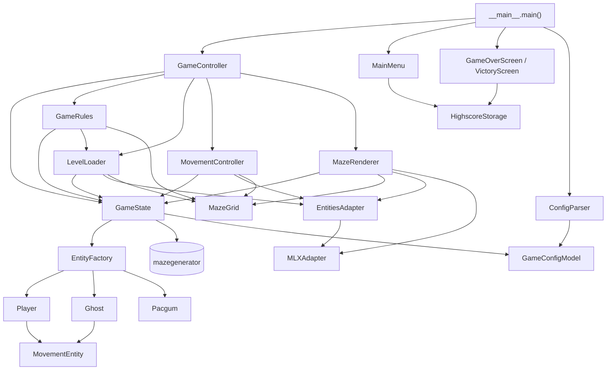

*This project has been created as part of the 42 curriculum by iarrien- and agomez-a.*

# Pac-Man

## Description

A complete and playable recreation of the arcade game **Pac-Man**, written in
Python with object-oriented programming. The goal of the project is to build
a modular, reusable game that is configured through a JSON file, generates its
levels with an external maze generator package and can be installed and
launched from a public platform (itch.io).

Overview of the game:

- A menu with **Start Game**, **View Highscores**, **Instructions** and
  **Exit**.
- At least **10 levels**. Each level is a maze generated by the provided
  `mazegenerator` package. The first level uses a fixed seed and the following
  ones are random.
- The player starts in the middle of the maze, with **4 ghosts** in the 4
  corners and **super pacgums** in the 4 corners too. Normal pacgums are
  placed in the corridors.
- A level is won when all the pacgums are eaten. The game is won when all the
  levels are completed, and lost when the lives run out or the level time
  reaches 0.
- Each ghost color has its own chasing behaviour.
- A pause menu, an in-game HUD (score, lives, level and remaining time), a
  cheat mode for peer review, and Game Over / Victory screens where the
  player saves the score in a persistent top 10.

## Instructions

### Requirements

- Python 3.13 (`requires-python = ">=3.13"` in `pyproject.toml`).
- [uv](https://docs.astral.sh/uv/), which the `Makefile` uses to manage the
  environment.
- Python dependencies (`pyproject.toml`): `pygame`, `pydantic`, `flake8`,
  `mypy` and the provided `mazegenerator` package.

### Installation

```bash
make install
```

This runs `uv sync` and installs every dependency, including the
`mazegenerator` wheel stored in `src/` (`mazegenerator-2.1.0-py3-none-any.whl`).

```bash
make install-module
```
To reinstall only the maze generator package.

### Execution

```bash
make run
```

This is the same as running `uv run python pac-man.py config.json`. The
program must be launched with **exactly one argument**, a configuration file
that ends in `.json`:

```bash
python3 pac-man.py config.json
```

Any error (missing file, invalid value, missing key, maze generator failure)
is reported with a message and not with a Python traceback.

### Makefile rules

| Rule | What it does |
|---|---|
| `make install` | Installs the dependencies with `uv sync`. |
| `make install-module` | Reinstalls the `mazegenerator` wheel from `src/`. |
| `make run` | Runs the game with `config.json`. |
| `make debug` | Runs the game with Python's debugger (`pdb`). |
| `make clean` | Removes the `__pycache__` folders and `.mypy_cache`. |
| `make lint` | Runs `flake8 .` and `mypy .` with `--warn-return-any --warn-unused-ignores --ignore-missing-imports --disallow-untyped-defs --check-untyped-defs`. |
| `make lint-strict` | Runs `flake8 .` and `mypy . --strict --ignore-missing-imports`. |
| `make package` | Builds the packaged game with PyInstaller (see [Packaging](#packaging)). |

### Controls

| Where | Keys |
|---|---|
| Move Pac-Man | Arrow keys or `W` `A` `S` `D` |
| Pause / resume | `ESC` or `P` |
| Menus | `Up`/`W` and `Down`/`S` to choose, `Enter` to select, `ESC` to go back |
| End screens | Type the name (letters, digits and spaces, up to 10 characters), `Backspace` to delete, `Enter` to save |

### Cheat mode

The cheat keys work during the game, to make peer review easier. They are
also listed in the **Instructions** screen of the menu.

| Key | Effect |
|---|---|
| `I` | Toggles invincibility (ghosts do not take lives). |
| `V` | Adds one life (the maximum is 10). |
| `B` | Toggles the speed boost of the player. |
| `F` | Toggles the ghost freeze (ghosts stop moving). |
| `L` | Skips the level (removes every pacgum, so the level ends). |

The icons of the active cheats (invincibility, speed boost and ghost freeze)
are shown on the screen.

## Configuration

The game is configured with a JSON file (`config.json` is provided). Lines
whose first non-blank character is `#` are comments and are ignored.

```json
# Comments start with '#'
{
  "highscore_filename": "highscores.json",
  "levels": [
    { "width": 25, "height": 25 },
    { "width": 16, "height": 16 }
  ],
  "lives": 3,
  "points_per_pacgum": 10,
  "points_per_super_pacgum": 50,
  "points_per_ghost": 200,
  "seed": 43,
  "level_max_time": 90
}
```

Every key is optional and has a default value, so an empty `{}` is a valid
configuration.

| Key | Meaning | Default | Valid values |
|---|---|---|---|
| `highscore_filename` | File where the highscores are saved. | `"highscores.json"` | Any string. |
| `levels` | List of levels, each one with a `width` and a `height` (in cells). | 10 levels of 20x20 | `width` and `height` between 5 and 100. |
| `lives` | Lives of the player at the start. | `3` | 1 to 10. |
| `pacgum` | Number of normal pacgums per level. | not set (see below) | Integer greater than 0. |
| `points_per_pacgum` | Points for eating a pacgum. | `10` | 1 to 99999. |
| `points_per_super_pacgum` | Points for eating a super pacgum. | `50` | 1 to 99999. |
| `points_per_ghost` | Points for eating a ghost. | `200` | 1 to 99999. |
| `seed` | Seed of the maze of the first level. | `42` | Integer greater than 0. |
| `level_max_time` | Time limit of each level, in seconds. | `90` | Integer greater than 0. |

Notes:

- **Levels:** the game always has at least 10 levels. If the file has fewer,
  it is completed with default levels (20x20) up to 10 and a notice is
  printed. The configuration uses the levels in order.
- **Level size:** a `width` or `height` below 5 is clamped to 5, above 100 is
  clamped to 100, and a value that is not a number falls back to 20. In each
  case a warning is printed.
- **Number of pacgums:** if `pacgum` is not set (or is invalid), each level
  gets 90 % of its free cells (cells that can be stepped on, without the
  corners and the center). If it is set, that number is used, limited to the
  free cells of the level.
- **Faulty values:** if a key has an invalid value (for example `"lives": 0`),
  a message is printed, that key is ignored and its default value is used.
  The valid keys are kept.
- **Missing keys:** a notice lists the keys for which the default is used.
- **Unknown keys** are ignored.
- **Faulty files:** if the file does not exist, has a syntax error or its root
  is not a JSON object, a message is printed and all the default values are
  used. The game never stops because of the configuration.

## Highscore

The highscores are stored in a JSON file (`highscore_filename`, by default
`highscores.json`) as a list of entries with a `name` and a `score`:

```json
[
    { "name": "Ana", "score": 1250 },
    { "name": "PLAYER", "score": 300 }
]
```

How it works:

- **Top 10:** only the 10 best scores are kept, sorted from the highest to the
  lowest. The **View Highscores** option of the main menu shows them.
- **Saving:** when the game ends (**Game Over** or **Victory**), the end
  screen asks for a name and saves the score with `Enter`.
- **Names:** up to 10 characters, only letters, digits and spaces. The spaces
  at the start and at the end are removed, and an empty name is saved as
  `PLAYER`.
- **Same name:** a name is unique in the list. If the name already exists, the
  screen shows the existing score and asks to press `Enter` again to
  overwrite it, or to change the name. The new score replaces the old one,
  even if it is lower.
- **Robustness to file errors:** if the file does not exist, the list is
  empty. If it is not valid, cannot be read or is not a list, it is renamed
  to `malformed_highscore.txt`, a warning is printed and the list starts
  empty. Entries that are not objects are ignored, and a missing or invalid
  score counts as 0.
- **Safe writing:** the scores are first written to a temporary file
  (`<filename>.tmp`) that then replaces the real file. If saving fails, the
  end screen shows a message and the next `Enter` closes it.
- **Where the code is:** `src/Ui/HighscoreStorage.py`, used by the main menu
  and by the end screens.

## Maze Generation

The levels are generated with the **`mazegenerator`** package (version 2.1.0),
which was provided with the project. It is used **as-is**, without modifying
it: the wheel is kept in `src/mazegenerator-2.1.0-py3-none-any.whl` and
declared as the source of the dependency in `pyproject.toml`. The game adapts
to its interface.

How the game uses it (`GameState.initializeMaze`):

```python
MazeGenerator((width, height), perfect=False, seed=seed)
```

- **`perfect=False`** generates an imperfect maze, which has loops, as the
  subject requires to get Pac-Man-compatible corridors.
- **Seed:** the first level uses the `seed` of the configuration, so it is
  always the same maze. The next levels use seed `0`, which the generator
  treats as fully random.
- **Size:** each level uses the `width` and `height` of its entry in the
  configuration.
- **Reading the maze:** the game reads the 2D list `maze.maze`, indexed as
  `[row][column]`. Each cell is an integer whose 4 low bits are the walls:
  `1` north, `2` east, `4` south and `8` west. `GameState.can_move` uses
  them to know if there is a wall between two neighbour cells, and
  `MazeRenderer` draws the walls from them.
- **The "42" pattern:** the generator draws a "42" inside the maze with cells
  closed on the four sides (value `15`). The game does not allow stepping on
  these cells, and no pacgum or entity is placed there.
- **Errors:** if the generator raises an exception, the game prints an error
  with the size of the maze and exits with code 1. If the package is not
  installed, the game prints a message asking to install it (`make install`)
  and exits.

## Implementation

Technical summary of how the game works.

**Game loop** (`GameController.run`)

- The loop runs at a maximum of 60 FPS. The time of each frame is limited to
  100 ms.
- In each frame it reads the events, draws the map, checks the collisions,
  plays the cheat animations, updates the timers and, if there are no
  pacgums left, loads the next level.
- The player and the ghosts take a step every 35 ms.

**Movement**

- Every entity has a cell position `(x, y)` and a pixel position
  `(x_pixel, y_pixel)`. The cell changes first and the pixel position then
  moves towards the new cell a little in each step, so the movement is
  animated. When the pixels reach the cell, the entity can move again.
- Each step is the size of a cell divided by 5 for the player (2.5 with the
  speed boost), by 10 for the ghosts and by 15 for a scared ghost.
- Walls are checked with `GameState.can_move`, which every entity receives as
  a function, so the entities do not know the maze.
- A key press sets the `desired_direction` of the player. Each time the
  player finishes a step, it tries to move in that direction.

**Collisions** (`GameRules.check_collisions`)

- They are checked with pixel positions. Every entity is a square of the size
  of a cell, reduced on each side by `min(6, cell_size / 4)` pixels.
- Touching a scared ghost eats it. Touching a ghost that is not scared takes a
  life, unless the player is invincible.

**Ghosts** (`src/Entities/Ghost.py`)

- The distances are computed with BFS (breadth-first search) from the target
  cell. The ghost chooses the neighbour cell with the shortest distance.
- If the best cell is blocked by another ghost, the ghost waits up to 12
  ticks and then takes the best free cell.
- Each color has its own target:
  - **Red:** the cell of the player.
  - **Pink:** a cell ahead of the player in the direction it moves.
  - **Blue:** it takes the cell 2 steps ahead of the player and doubles the
    line from the red ghost to that cell.
  - **Yellow:** it chases the player, but when it is closer than 8 cells it
    goes back to its home corner, until it is farther than 11 cells.
- While scared, a ghost flees directly from the player when closer than 8
  cells (until it reaches a distance greater than 11 cells), and goes back
  to its home corner once at a safe distance.
- A super pacgum scares all the ghosts for 7 seconds. In the last 2 seconds
  the scared ghosts blink.
- An eaten ghost goes back to its corner, is not drawn or moved for 5 seconds
  and then comes back.

**Levels and rules**

- The player starts in the center cell, and the ghosts in the corners: red
  top-left, yellow bottom-left, blue top-right and pink bottom-right. The
  super pacgums are in the 4 corners. The normal pacgums are placed in random
  cells that can be stepped on, not in the corners or in the center.
- The player keeps the score and the lives between levels. A level ends when
  there are no pacgums and no super pacgums left.
- After losing a life, the player goes back to the center and the ghosts to
  their corners. When the lives reach 0, the game is over.
- Each level has a timer. When it reaches the limit, the game prints
  `Time is up! Game Over.` and the player loses the game.
- When the last level is completed, the Victory screen is shown. After an
  end screen, the game goes back to the main menu.

**Rendering**

- The walls of a level are drawn once on a separate surface (`maze_ui`), and
  that surface is drawn in each frame. This avoids drawing every wall again
  in every frame.
- The images are scaled to the size of the cells, loaded when the game starts
  and cached. If any image is missing, the game reports it before starting.

### MLX compatibility

> this section is **empty on purpose**. It has to be
> discussed with the partner before writing it: which equivalences with the
> MLX library are declared for the pygame functions that the project still
> uses, and how they are justified.

## General Software Architecture

The project is split in four packages inside `src/`, plus the entry point.

| Module | Content |
|---|---|
| `pac-man.py` | Launcher. It only calls `main()` of `src/__main__.py`. |
| `src/__main__.py` | Checks the arguments, loads the configuration, builds every component and runs the cycle: menu, game, end screen, back to the menu. |
| `src/Config/` | `ConfigParser`, with the Pydantic models `GameConfigModel` and `LevelConfig`. |
| `src/Entities/` | `MovementEntity` (base class) and its subclasses `Player` and `Ghost`, plus `Pacgum` and `EntityFactory`. |
| `src/Game/` | `GameState`, `GameRules`, `LevelLoader`, `MovementController` and `GameController`. |
| `src/Ui/` | `MazeGrid`, `MazeRenderer`, `EntitiesAdapter`, `MLXAdapter`, `MainMenu`, the end screens (`EndScreenBase`, `GameOverScreen`, `VictoryScreen`) and `HighscoreStorage`. |

Responsibilities:

- **`GameState`** keeps the state of the game: configuration, current level,
  player, ghosts, pacgums, timers, pause and the maze. It also reads the
  keyboard events.
- **`GameRules`** applies the rules: eating pacgums, collisions, losing a
  life and timers.
- **`LevelLoader`** creates the entities of each level and puts them in place,
  using `EntityFactory`.
- **`MovementController`** moves the entities pixel by pixel.
- **`GameController`** runs the game loop and connects the other classes.
- **`MazeGrid`** converts cells into pixels. **`MazeRenderer`** draws the
  maze, the entities, the HUD and the menus of the game.
- **`EntitiesAdapter`** gives the images of the entities. **`MLXAdapter`**
  has the drawing helpers that work pixel by pixel.

Relations between the classes. An arrow means that a class uses or creates
the other one, except the arrows to `MovementEntity`, which mean inheritance:



## Packaging

The game can be packaged with `make package`, which runs PyInstaller (the
`pac-man.spec` file and the `package` rule of the `Makefile` are at the
root of the repository). The rule installs the dependencies, builds the game
with the images of `src/img`, and creates `dist/pac-man-linux.zip` with the
game, `config.json`, `launch.sh` and the in-package instructions
(`packaging/README.txt`).

The packaged game can be published on itch.io as a free, unlisted build.

## Project Management

The project was planned and tracked with a timeline (Gantt charts made with
Mermaid) and a comparison between the plan and the real progress, which was
taken from the `git log`. All the documents are in the
[`documentation/`](documentation/managment.md) directory.

**Plan against real progress**

| Block | Plan | Real | Deviation |
|---|---|---|---|
| Base (Player and Ghost) | 17/10 - 22/10 | 15/10 - 20/10 | Ahead by about 2 days |
| Interface and config | 20/10 - 28/10 | 20/10 - 26/10 | Slightly ahead |
| Screens and data | 27/10 - 01/11 | 26/10 - 29/10 | Ahead |
| Extras (cheats, AI) | 01/11 - 05/11 | 29/10 - 06/11 | Longer: many polishing bugs |
| Quality (lint, mypy) | 04/11 - 06/11 | 03/11 - 06/11 | As planned |
| MLX adaptation | 05/11 - 08/11 (3 days) | 06/11 - 10/11 (4 days) | Underestimated: most of the work was replacing pygame functions that have no MLX equivalent |
| Architecture refactors | Not planned | 29/10 - 03/11 and 09/11 - 10/11 | Added work, not expected |
| Documentation and tests | 08/11 - 11/11 | 10/11 - 11/11 | Late, it was left to the end |

**Team organization**

- **Alejandro:** base of `Player` and `Ghost` together with `EntityFactory`;
  first search and flee algorithms of the ghosts; parsing of the input; the
  logic to kill Pac-Man and to create the icons; the end screens together
  with the score table; refactor of `MazeRenderer` to abstract the loading of
  the level and the movement.
- **Iker:** first version of the interface using the native pygame
  functions; speed logic; repositioning logic and refactor of
  `MovementEntity` to avoid passing unnecessary functions between functions;
  the specific movement algorithm of each ghost; refactor of `MazeRenderer`
  to split its responsibilities between `MazeGrid` and `GameState`.

**Conflicts and blocking points**

There were no serious conflicts, because the project was planned well from
the start. These were the main issues:

- `MazeRenderer` had too many responsibilities and, at one point, handled
  everything needed to render. It was refactored twice to split them.
- Adapting the pygame functions to be valid. The biggest problem was
  performance, because every wall was generated again from scratch in every
  frame. It was solved by drawing the maze on a surface that is reused.

## Resources

- [Pygame documentation](https://www.pygame.org/docs/)
- [uv documentation](https://docs.astral.sh/uv/)
- [PyInstaller documentation](https://pyinstaller.org/)
- [Breadth-first search](https://en.wikipedia.org/wiki/Breadth-first_search),
  the algorithm used to compute the distances of the ghosts
- [The Pac-Man Dossier](https://pacman.holenet.info/), about the behaviour of
  the original ghosts

### Use of AI

