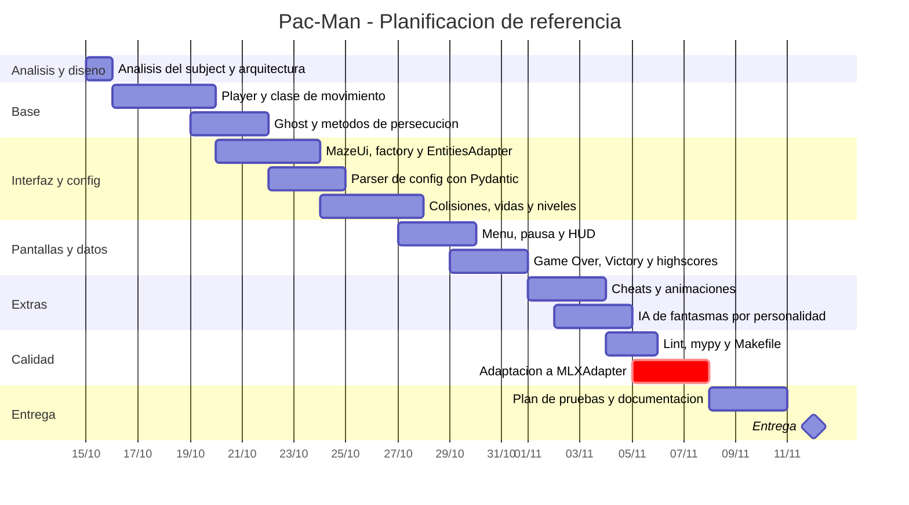
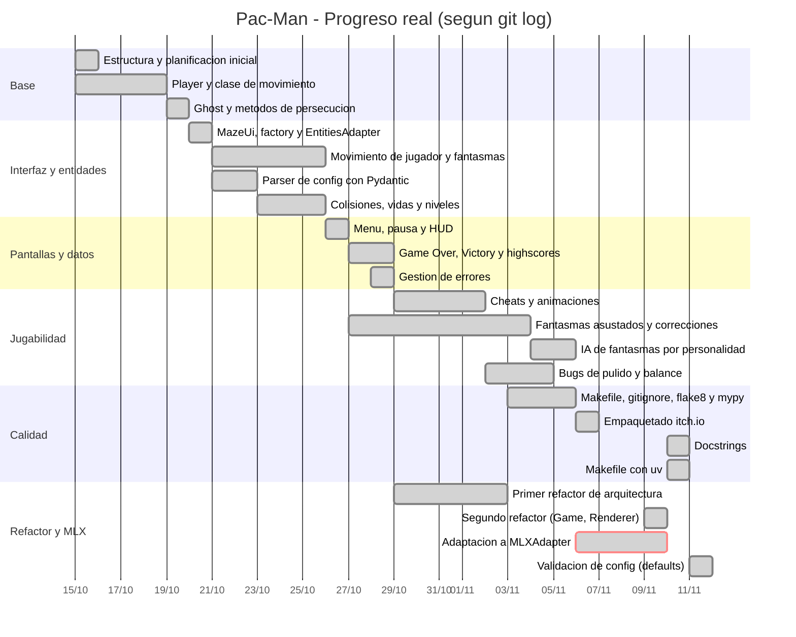

# Timeline del proyecto Pac-Man
 
## 1. Planificación de referencia
 

 
## 2. Progreso real (según git log)
 

 
## 3. Plan frente a real
 
| Bloque | Plan | Real | Desviación |
|---|---|---|---|
| Base (Player y Ghost) | 17/10 - 22/10 | 15/10 - 20/10 | Se adelantó unos 2 días |
| Interfaz y config | 20/10 - 28/10 | 20/10 - 26/10 | Ligeramente adelantado |
| Pantallas y datos | 27/10 - 01/11 | 26/10 - 29/10 | Adelantado |
| Extras (cheats, IA) | 01/11 - 05/11 | 29/10 - 06/11 | Más largo: muchos bugs de pulido |
| Calidad (lint, mypy) | 04/11 - 06/11 | 03/11 - 06/11 | Según lo previsto |
| Adaptación a MLX | 05/11 - 08/11 (3 días) | 06/11 - 10/11 (4 días) | Se infravaloró: la mayor parte del trabajo estuvo en reemplazar funciones de pygame sin equivalente |
| Refactores de arquitectura | No planificados | 29/10 - 03/11 y 09/11 - 10/11 | Trabajo añadido, no previsto |
| Documentación y pruebas | 08/11 - 11/11 | 10/11 - 11/11 | Retrasado, se concentró al final |

# DIvision de responsabilidades en el proyecto

## Alejandro

- Desarrollo de base para Player y Ghost junto con EntityFactory
- Desarrollo de primeros algoritmos de busqueda y huida de fantasmas
- Parseo de entrada
- Añadidas logicas para matar pacman y crear iconos
- Añadidas pantalla de finalizacion junto con tabla de scores
- Refactorizacion de MazeRenderer para abstrar la carga de nivel y el movimiento

## Iker

- Desarrollo de una primera version de la interfaz haciendo uso de las funciones nativas de pygame
- Desarrollo de logicas de velocidad
- Añadidas logicas de reposicionamiento y refactorizacion de MovementEntity para evitar enviar funciones innecesarias entre funciones
- Desarrollo de algoritmos de movimiento concretos de cada uno de los fantasmas
- Refactorizacion de MazeRenderer para dividir responsabilidades entre mazeGrid y GameState

# Conflictos

Lo cierto es que no hemos tenido conflictos demasiado importantes. habiamos planteado bastante bien el proyecto y ha habido pocas cosas que nos romperian la logica completa

- Excesivas responsabilidades sobre la clase MazeRenderer, la cual en un momento del proyecto se ocupaba de todo lo necesario para renderizar
- Adaptacion de funciones de pygame para que fueran validas. Esto los mayores conflictos que ha dado eran de optimizacion, ya que, abusabamos mucho de renderizar cada cada muro en cada vuelta, generandolo de nuevo desde 0, lo cual lo resolvimos haciendo una superficie que ibamos renderizando